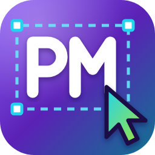

  

<h1 align="center">PM VisualForge</h1>

<b>Visual HTML · CSS · JS editor for VS Code &amp; Antigravity</b> 
Dreamweaver-style click-to-edit design, live browser preview, image editor, link manager and an advanced color studio, all inside your editor.

by <a href="https://www.pawanmall.in/">Pawan Mall</a> · <a href="https://www.webdevservices.in/">webdevservices.in</a>

  
  
  
  

---

## ⬇️ Download & install

**[Download the latest release (.vsix)](https://github.com/MrPawanMall/pm-visualforge/releases/latest)**

- **VS Code / Antigravity / Cursor / Windsurf:** Extensions view → `⋯` menu → **Install from VSIX…** → pick the downloaded file.
- **Command line:** `code --install-extension pm-visualforge-1.0.0.vsix`
- **Open VSX:** [open-vsx.org/extension/pawanmall/pm-visualforge](https://open-vsx.org/extension/pawanmall/pm-visualforge). Search for **PM VisualForge** in VSCodium, Antigravity or any Open VSX-based editor.

> This repository holds the documentation and release builds only.

---

## ✨ Features

### 🖱 Visual canvas
- Open any `.html` page and **click** an element to select it. **Double-click** text to type in place, with a bold, italic, underline and link toolbar.
- Hovering shows outlines. A selected element also shows its **margin** (orange) and **padding** (green).
- Each selected element gets a floating toolbar: select parent, **drag to move**, edit text, link, image, duplicate, delete and more.
- **Right-click** an element for a menu: copy/paste element, move up/down, wrap in link or `
`, reveal in code.
- Keyboard: `Del` deletes, `Ctrl+D` duplicates, `Esc` selects the parent, arrow keys move between siblings, `Alt+↑/↓` reorders, `Enter` edits text, and `Ctrl+Z / Ctrl+Y / Ctrl+S` undo, redo and save.
- **Edit / Preview** toggle. Preview mode lets you click links, open menus and run scripts the way a visitor would.

### 📱 Responsive design
- Desktop, laptop, tablet and mobile frames, plus any custom width, with zoom-to-fit.
- **"Only on screens ≤ N px"** writes styles into the right `@media (max-width: N px)` block.

### 🎨 Full style inspector
- **Apply to**: inline style, any matching **class rule** (in an external `.css` file or the page `<style>`), a new class or an `#id` rule.
- Layout (block/flex/grid with all alignment controls, position, overflow), size, a visual **box-model** editor, typography, background (color, image, gradients), border and radius, and effects (opacity, shadows, transform, filter, backdrop, transition, cursor, blend).
- **Scrub** numbers by dragging a label. ↑/↓ keys step the value, `Shift` ×10.
- The *All declared properties* section lets you add any CSS property. *Matched CSS rules* shows every rule that applies to the element, and you can click one to edit it.

### 🖼 Image editor
- Crop with aspect presets (1:1, 4:3, 16:9, 9:16…) and drag handles, rotate, flip and straighten.
- Resize with locked ratio, percentage or preset widths.
- Brightness, contrast, saturation, hue, blur, grayscale, sepia, invert and opacity, plus one-click filters (Vivid, Warm, B&W, Vintage…).
- Rounded corners, PNG / JPEG / **WebP** export with a quality slider and **live file-size estimate**, and a hold-to-compare *before* view.
- **Alt text**, title, lazy loading and width/height attributes, all from one panel.
- Save as a new file, or overwrite the original (a backup is kept). You can also apply the adjustments as a **non-destructive CSS filter**.
- Works on any image file too: right-click it in the Explorer and choose **Edit Image…**.

### 🔗 Link management
- **Link Manager** lists every link, image, script and stylesheet on the page with its status: OK, missing file, missing anchor, or checked external URL.
- Edit URLs inline and toggle *new tab*. Bulk actions: find & replace in URLs, open external links in a new tab, add `noopener`/`nofollow`, upgrade `http → https`.
- The **link dialog** builds a web URL, picks a page of your site, a section (`#id`), an email (with subject), a phone number or a WhatsApp chat.
- The inspector **Link** section edits href, target, rel (noopener, noreferrer, nofollow, sponsored, ugc), title and download.

### 🌈 Color Studio (advanced)
- HSV picker with hue and alpha sliders.
- **HEX, RGB, HSL, HWB, OKLCH** inputs, each with a copy button.
- **Eyedropper**, colors already **used on the page**, **CSS variables** (`var(--brand)`), your saved swatches and recent colors.
- Harmonies: complementary, analogous, triadic, split-complementary and tetradic.
- An 11-step **shade scale** (50–950).
- **WCAG contrast checker** (AA/AAA) with an **auto-fix** that finds the nearest passing color.
- **Gradient builder** (linear / radial / conic) with draggable color stops and presets.
- Also opens on its own (**PM VisualForge: Color Studio**) and can insert colors into any CSS file.

### 🌐 Live preview
- A built-in local server (bound to `127.0.0.1` only) serves your site, including **unsaved** changes.
- **Live Preview in Browser** opens your default browser. The page reloads on every change, and CSS changes hot-swap without a reload.
- Changes made in the code editor (by you or an AI agent) appear on the canvas immediately, and the reverse is also true.

### 🔎 Page settings, SEO & audit
- Title, meta description (with character counters), keywords, canonical URL, robots, language, charset, viewport and favicon, plus **Open Graph / Twitter** tags with a **Google search preview**.
- **Audit** checks for missing alt text, low contrast, heading-order jumps, unlabeled form fields, empty links and buttons, duplicate ids and missing meta tags. It gives a score, and each issue has a one-click fix or jumps to the element.

### 🧱 Insert library
Headings, paragraphs, buttons, lists, quotes, sections, containers, 2- and 3-column layouts, grids, cards, images, figures, video, YouTube, maps, audio, embeds, forms and fields, tables, navbars, heroes, feature grids, CTAs, footers, and custom HTML. **Click** a block to insert it, or **drag** it onto the canvas or the Layers tree.

### 🎓 Tutorial mode
Turn on **Tutorial** for a spotlight tour of every part of the editor. While it is on, hovering any button shows what it does.

### More
- **Layers** tree: search, collapse, drag to reorder, right-click actions.
- **Pages** panel and an activity-bar view listing every page in your site.
- **New Page** from a responsive starter template, and **Import Web Page from URL** to edit any live page locally.
- A **Code** tab edits one element's HTML. *Reveal in code* jumps to that line.

## 🚀 Getting started
1. Open a folder that contains `.html` files.
2. Open a page and click the **✎ Open Visual Editor** button in the editor title bar, or press `Ctrl+Alt+V`, or right-click the file → **Open Visual Editor**.
3. Click **Live** to see the page in your browser.
4. New here? Click **🎓 Tutorial**.

> You can also use *Open With… → PM VisualForge (Visual Editor)* on any HTML file.

## ⚙️ Settings
| Setting | Default | Description |
|---|---|---|
| `pmVisualForge.port` | `5600` | Preferred live-server port (next free port if busy) |
| `pmVisualForge.siteRoot` | `""` | Sub-folder used as the web root (e.g. `public`) |
| `pmVisualForge.autoSave` | `true` | Save after each visual edit |
| `pmVisualForge.liveReload` | `true` | Inject the live-reload client into browser previews |
| `pmVisualForge.reloadOn` | `change` | Reload the browser on every change or only on save |
| `pmVisualForge.defaultStyleTarget` | `inline` | Write styles inline or into the first matching class rule |
| `pmVisualForge.imageFolder` | `images` | Where new and edited images go |

## 🔒 Privacy & security
- **No telemetry.** Nothing about you or your code is collected or sent anywhere.
- The preview server listens on `127.0.0.1` only and rejects foreign `Host` headers, which protects against DNS rebinding.
- External requests happen only when you ask for them: *Check external links*, *Import from URL*, or editing a remote image.

## 🧩 Compatibility
VS Code 1.82+ and VS Code-based editors such as **Google Antigravity**, Cursor, Windsurf and VSCodium (install the `.vsix`).

## 👤 About the author
| | |
|---|---|
| **Author** | Pawan Mall |
| **Website** | [www.pawanmall.in](https://www.pawanmall.in/) |
| **Tools & Plugins** | [www.webdevservices.in](https://www.webdevservices.in/) |
| **Email** | [pawan.webmaster@gmail.com](mailto:pawan.webmaster@gmail.com) |
| **GitHub** | [github.com/MrPawanMall](https://github.com/MrPawanMall) |
| **Partner** | [MyQRStudio](https://myqrstudio.in/): Create QR Codes That Do More. |

More by PM: **Claude Studio by PM**, **Account Switcher for Claude by PM**, **Claude Auto Open**, and the free tools at [webdevservices.in](https://www.webdevservices.in/).

## 📄 License
[MIT](LICENSE) © 2026 Pawan Mall
